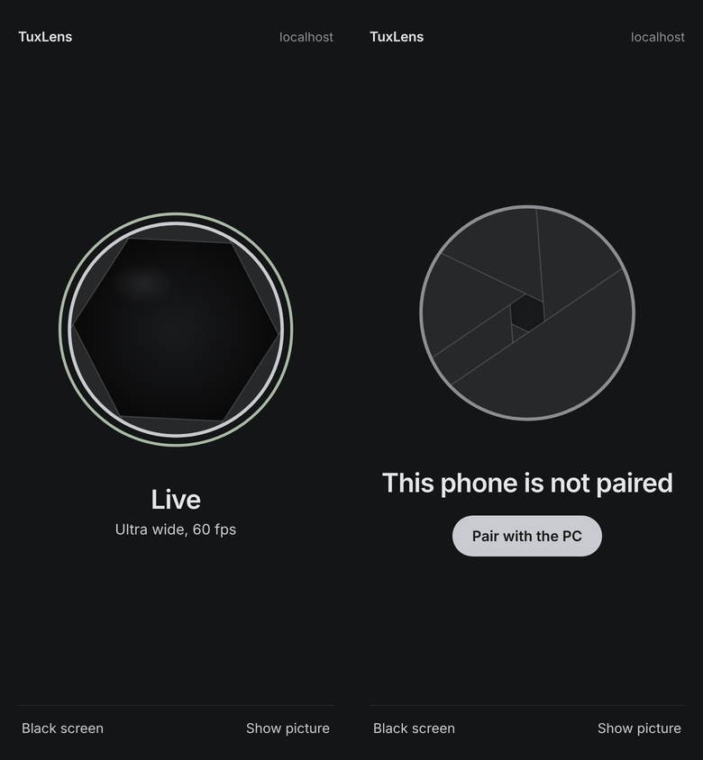

# TuxLens

Usa el móvil como webcam en Linux, con muy poco retraso y controlado desde el escritorio.

TuxLens convierte el navegador del móvil en una cámara para tu PC por Wi-Fi. Aparece como una
webcam normal (y, si quieres, como micrófono) en Google Meet, Zoom, OBS o cualquier otra app. Todo se
controla desde Linux: lente, zoom, linterna, fondo desenfocado, fondo con imagen, encuadre
automático y filtros. En el móvil solo se aceptan permisos una vez.

[Read in English](README.md)



## Por qué

Las apps para usar el móvil como webcam o no tienen cliente para Linux o guardan lo bueno tras una
suscripción. TuxLens no instala nada desde la tienda: el móvil abre una página que sirve tu propio
PC, así que funciona con un iPhone sin cuenta de desarrollador y nada sale de tu red. Android con
Chrome tiene las mismas APIs web, pero está sin probar.

## Qué hace

- **Poco retraso.** Unos 80 ms desde que la luz entra en el móvil hasta que se ve en Chrome a 720p60,
  medido en el equipo del autor (iPhone por Wi-Fi, PC por cable). Dentro del PC, desde que llega el
  fotograma hasta la cámara virtual, unos 16 ms.
- **Cualquier lente.** Gran angular (0.5×), principal, teleobjetivo y frontal, elegidas desde el PC,
  más zoom y linterna. Lo que el móvil no tenga sale desactivado.
- **Cualquier postura.** La imagen se endereza con el acelerómetro del móvil, así que puede ir en
  vertical, en horizontal o boca abajo.
- **Fondo desenfocado o con imagen.** En la CPU, con el modelo selfie de MediaPipe de Google (unos
  10 ms por fotograma a 720p), con bordes limpios en el pelo y las manos.
- **Encuadre automático.** Te sigue cuando te mueves, al estilo de Center Stage de Apple, con la misma
  máscara de la persona (sin modelos extra).
- **Filtros.** B/N, cálido, frío, vivo, brillo y contraste.
- **Micrófono del móvil.** Micrófono virtual opcional alimentado por el móvil, con su reducción de
  ruido, ganancia en el panel y medidor de nivel.
- **También webcams.** Elige cualquier cámara USB o integrada en vez del móvil y conserva todos los
  efectos. Los controles propios de la cámara (exposición, enfoque, balance de blancos, zoom
  óptico…) aparecen en el panel si los tiene.
- **Privacidad primero.** La cámara real solo se abre mientras una app usa TuxLens (o el panel está
  abierto), así que el LED de la webcam se comporta como el de una webcam normal y la webcam queda
  libre para las apps que la usan directamente. El interruptor del panel, `tuxlens off` o el clic
  derecho en el icono de la barra la apagan del todo; las apps ven entonces «Cámara apagada».
- **Integración con el escritorio.** Panel GTK4 con vista previa en vivo, módulo para waybar, CLI y
  una imagen de «cámara en pausa» para que Meet no pierda la cámara cuando el móvil se va.
- **Temas.** Todo (panel, página del móvil, icono de la barra, imagen de pausa) sale de un pequeño
  tema JSON. Incluye cinco, y hacer uno propio son unas pocas líneas.


## Cómo funciona

```
Móvil (página en Safari/Chrome, HTTPS)         PC: tuxlensd (servicio de usuario en Python)
cámara → WebCodecs VideoEncoder (H.264,  ──►  WebSocket → PyAV (decodificación sin retraso)
  por hardware, tiempo real, sin B-frames)      → buzón de un hueco (gana el fotograma más nuevo)
micrófono → PCM 48 kHz sin comprimir     ──►    → recorte / giro / efectos / encuadre
                                                → /dev/video10 «TuxLens» (v4l2loopback, I420)
control: lente, zoom, linterna, keyframes ◄──   → fuente de PipeWire «TuxLens» (micrófono)
```

Decisiones que bajan el retraso, todas medidas:

- **WebCodecs por WebSocket en vez de WebRTC.** El mismo codificador por hardware, pero sin pacer,
  sin rampa de bitrate y sin jitter buffer, y se puede pedir un keyframe al instante.
- **Ninguna cola.** Los fotogramas decodificados van a un buzón de un hueco: si un paso va lento, se
  salta fotogramas en vez de acumular retraso. El móvil descarta fotogramas *antes* de codificar si
  la Wi-Fi da un bache.
- **`AV_CODEC_FLAG_LOW_DELAY`** en el decodificador e **I420** hacia v4l2loopback, que es el primer
  formato que pide Chromium, así que no se vuelve a convertir.
- **Efectos baratos.** La máscara se calcula sobre una miniatura de 256×144 en segundo plano, el
  desenfoque se hace a 1/8 del tamaño, los contextos de swscale se reutilizan y la mezcla se hace in
  situ con int16.

## Requisitos

- Linux con **v4l2loopback** y PipeWire (para el micrófono, opcional).
- **Python 3.10+** con `aiohttp`, `av` (PyAV), `numpy`, `pycairo`, `onnxruntime` y PyGObject con GTK 4
  (el panel usa **gtk4-layer-shell** en wlroots/Hyprland/Sway; en otros entornos se abre como ventana
  normal).
- `openssl`, `v4l2loopback-ctl`; opcionales `v4l2-ctl` (controles de la webcam), `qrencode` (QR) y
  `notify-send` (avisos de emparejamiento).
- Un móvil con navegador reciente. Probado con **Safari 27 en iPhone**. La página necesita
  `VideoEncoder` de WebCodecs y `MediaStreamTrackProcessor` en un worker.

En Arch Linux:

```sh
sudo pacman -S --needed python-aiohttp python-av python-numpy python-cairo python-onnxruntime-cpu \
  python-gobject gtk4 gtk4-layer-shell v4l2loopback-dkms v4l2loopback-utils v4l-utils openssl \
  qrencode libnotify
```

## Instalación

```sh
git clone https://github.com/hxst1/tuxlens.git
cd tuxlens
./install.sh
```

El instalador añade dos servicios:

- `tuxlens-loopback.service` (de sistema, pide sudo una vez) crea `/dev/video10` con el nombre
  **TuxLens** al arrancar. Añade su propio dispositivo, sin tocar OBS ni otros usuarios de loopback.
- `tuxlens.service` (de usuario) ejecuta el daemon desde tu copia del repo.

También enlaza `tuxlens` y `tuxlens-panel` en `~/.local/bin`. Para quitarlo todo:
`./install.sh --uninstall`.

## Emparejar el móvil (una vez)

1. Ejecuta `tuxlens pair` y escanea el QR con el móvil (en la misma Wi-Fi).
2. Descarga el certificado e instálalo: **Ajustes → Perfil descargado → Instalar**, y luego
   **Ajustes → General → Información → Ajustes de confianza de certificados → activa «TuxLens local
   CA»**. El certificado se crea en tu PC solo para esta instalación y sirve para que el móvil confíe
   en tu PC.
3. Abre la página de la cámara y permite la cámara. Si quieres, **Compartir → Añadir a pantalla de
   inicio**.

Más adelante, si un móvil no está emparejado, su página muestra **Emparejar con el PC**: púlsalo y
acepta la solicitud en el PC, desde la notificación o desde el panel. Solo se aceptan direcciones de
red privadas, y no se concede nada sin ese clic.

Para que arranque solo, crea una automatización en Atajos de iOS: *Al conectarse a tu Wi-Fi → Abrir
URL* con la dirección de la página de la cámara.

## Uso

Elige **TuxLens** como cámara (y **TuxLens (micrófono del iPhone)** como micrófono, si lo activas) en
Meet, Zoom u OBS.

El **panel** (`tuxlens panel`, o clic en el icono de la barra) tiene vista previa en vivo, fuente,
lente, zoom, linterna, micrófono y ajustes de audio, modo *rápido 720p60* o *nítido 1080p30*, giro,
efectos, filtros y tema. Las secciones se pliegan y recuerdan cómo las dejaste.

La **CLI**:

```sh
tuxlens status                 # estado y retraso por etapas
tuxlens camera wide            # front | back | wide | tele
tuxlens source webcam          # o: tuxlens source phone, tuxlens source (lista)
tuxlens effect blur            # none | blur | image ~/Imágenes/oficina.jpg
tuxlens set framing=true fps=60 capture=720p mic=true
tuxlens theme catppuccin-mocha
tuxlens off                    # interruptor de privacidad (tuxlens on / tuxlens toggle)
tuxlens approve                # aceptar una solicitud de emparejamiento
tuxlens reload-phone           # recargar la página del móvil tras actualizar
```

### Waybar

```jsonc
"modules-right": ["image#tuxlens", /* … */],

"image#tuxlens": {
    "exec": "~/.local/bin/tuxlens waybar --image",
    "size": 16,
    "interval": 60,
    "signal": 13,
    "tooltip": true,
    "on-click": "~/.local/bin/tuxlens panel",
    "on-click-right": "~/.local/bin/tuxlens toggle"
}
```

Luego `tuxlens set waybar_signal=13` para que el daemon refresque el icono en cuanto cambie su
estado. Para una barra de texto, `tuxlens waybar` imprime JSON con un glifo Nerd Font y una `class`
(`idle`, `waiting`, `live`, `pairing`, `error`, `disabled`, `off`).

## Temas

Los temas están en `themes/*.json`; los tuyos van en `~/.config/tuxlens/themes/<nombre>.json`, y si
se llaman como uno incluido, mandan los tuyos. Lo que falte se rellena con valores por defecto, así
que un tema puede ser mínimo:

```json
{
  "name": "El mío",
  "dark": true,
  "colors": { "background": "#101418", "accent": "#7fb4ff", "success": "#8bd5a0" },
  "glass": { "rgb": "16, 20, 24", "alpha": 0.6, "blur": 18, "border": "rgba(255,255,255,0.08)" },
  "radius": 14,
  "font": "Inter",
  "bar": { "icon": "#f4f5f6", "active": "#8bd5a0" }
}
```

Colores: `background`, `surface`, `surface_alt`, `text`, `text_secondary`, `muted`, `accent`,
`on_accent`, `danger`, `success`. Para retoques del panel que los tokens no cubren, añade CSS de GTK
en `~/.config/tuxlens/extra.css`. Temas incluidos: **niebla** (por defecto), **paper** (claro),
**catppuccin-mocha**, **nord** y **solid** (para compositores sin blur).

## Problemas frecuentes

- **Imagen de lado.** Pulsa *Activar giro automático* en la página del móvil (permiso de
  movimiento), o usa los botones de giro del panel.
- **Más retraso del esperado.** Comprueba que el modo es *Rápido · 60 fps*. El gran angular solo da
  60 fps a 720p. La cifra del panel es el tramo del móvil al PC, no el retraso total.
- **La webcam va a pocos fps con poca luz.** Es la exposición automática alargando cada fotograma.
  En *Ajustes de la cámara*, pon *Exposición → Manual* y un tiempo de exposición corto.
- **La página dice «Sin conexión con el PC».** ¿Misma Wi-Fi? ¿Está en marcha
  `systemctl --user status tuxlens`? ¿Están abiertos los puertos 7790 (HTTPS) y 7791 (emparejamiento)
  en el cortafuegos?
- Registro: `journalctl --user -u tuxlens -f`.

Cosas de Safari 27 aprendidas por las malas y resueltas en el código: entrega los fotogramas en la
orientación del sensor con `VideoFrame.rotation` a 0; ignora `visibleRect` al codificar (la imagen
sale aplastada); y el vídeo va en rango completo, `yuvj420p`.

## Desarrollo

```sh
python3 -m tuxlensd -v              # daemon desde el repo
python3 tools/fake-phone.py         # móvil simulado (patrón de prueba con x264, mismo protocolo)
python3 -m unittest discover tests  # pruebas
```

`tools/latency.html` mide el retraso de cristal a cristal: apunta el móvil al contador de la
izquierda y haz capturas; la mitad derecha muestra lo que ve la cámara virtual.

## Licencia

MIT, ver [LICENSE](LICENSE). El modelo de segmentación incluido es © Google, Apache-2.0
([assets/models/NOTICE.md](assets/models/NOTICE.md)).
