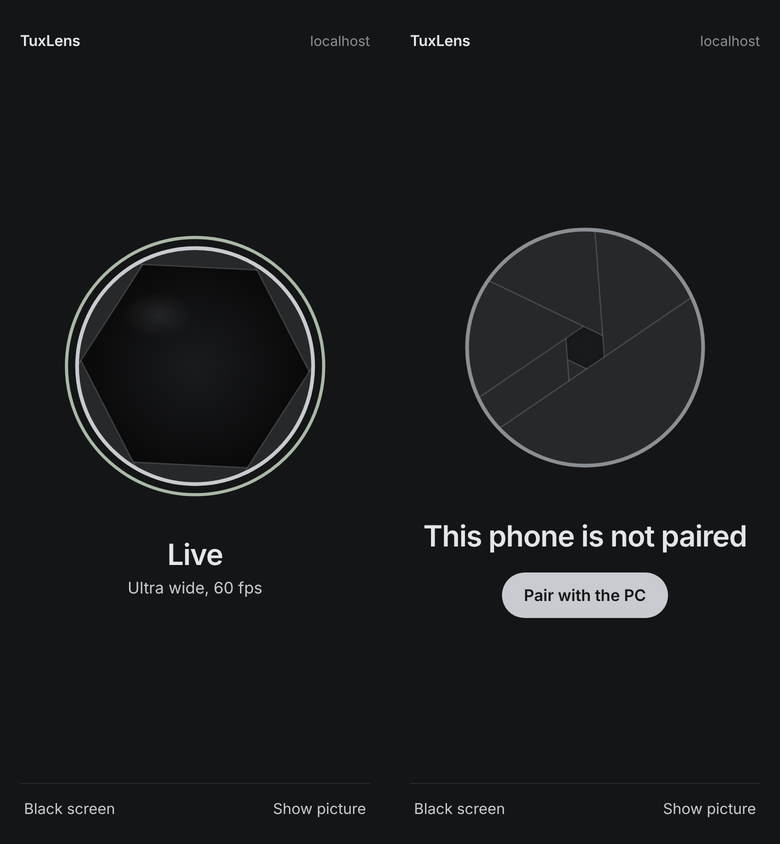

# TuxLens

Use your phone as a webcam on Linux, with very low lag, controlled from your desktop.

TuxLens turns the phone's browser into a camera for your PC over Wi-Fi. It shows up as a normal
webcam (and, if you want, a microphone) in Google Meet, Zoom, OBS or anything else. Everything is
controlled from Linux: which lens, zoom, torch, background blur, background picture, auto-framing,
filters. On the phone you only grant permissions once.

[Leer en español](README.es.md)



## Why

Phone-as-webcam apps either have no Linux client or keep the good parts behind a subscription.
TuxLens needs no app store install: the phone runs a web page served by your own PC, so it
works with an iPhone without a developer account, and nothing leaves your network. Android with
Chrome has the same web APIs but is untested.

## Features

- **Low latency.** About 80 ms from light hitting the phone to the picture in Chrome at 720p60,
  measured on the author's setup (an iPhone on Wi-Fi, PC on Ethernet). Inside the PC, frame
  arrival to virtual camera takes about 16 ms.
- **Any lens.** Ultra wide (0.5×), main, telephoto and front camera, chosen from the PC, plus zoom
  and torch. Controls the phone doesn't have are disabled.
- **Any position.** The picture is turned upright from the phone's accelerometer, so the phone can
  rest upright, sideways or upside down.
- **Background blur and background pictures.** Runs on the CPU with Google's MediaPipe selfie
  model (about 10 ms per frame at 720p), with a clean edge around hair and hands.
- **Auto-framing.** Follows you when you move, in the spirit of Apple's Center Stage, using the
  same person mask (no extra model).
- **Filters.** B/W, warm, cool, vivid, brightness and contrast.
- **Phone microphone.** Optional virtual microphone fed by the phone, with the phone's own noise
  reduction, gain control in the panel and a level meter.
- **Webcams too.** Pick any USB or built-in camera instead of the phone and keep every effect.
  The camera's own controls (exposure, focus, white balance, optical zoom…) appear in the panel
  when it has them.
- **Privacy first.** The real camera only opens while an app is using TuxLens (or the panel is
  open), so the webcam light behaves like a normal webcam's and the webcam stays free for apps that
  use it directly. A camera switch in the panel, `tuxlens off`, or a right click on the bar icon
  turns it off completely; apps then see a "camera off" picture.
- **Desktop integration.** GTK4 control panel with a live preview, a waybar module, a CLI, and a
  "camera paused" picture so Meet never loses the camera when the phone goes away.
- **Themes.** Every surface (panel, phone page, bar icon, paused picture) is drawn from one small
  JSON theme. Five themes are included; making your own is a few lines.


## How it works

```
Phone (Safari/Chrome page, HTTPS)              PC: tuxlensd (Python user service)
camera → WebCodecs VideoEncoder (H.264,  ──►  WebSocket → PyAV decode (low delay)
  hardware, realtime, no B-frames)              → one-slot mailbox (newest frame wins)
microphone → raw 48 kHz PCM            ──►      → crop / rotate / effects / framing
                                                → /dev/video10 "TuxLens" (v4l2loopback, I420)
control: lens, zoom, torch, keyframes  ◄──      → PipeWire source "TuxLens" (microphone)
```

Design choices that keep the lag down, each measured:

- **WebCodecs over WebSocket instead of WebRTC.** Same hardware encoder, but no pacer, no bitrate
  ramp-up and no jitter buffer, and a keyframe can be requested instantly.
- **No queues anywhere.** Decoded frames go into a one-slot mailbox; a slow step skips frames
  instead of adding delay. The phone drops frames *before* encoding when Wi-Fi hiccups.
- **`AV_CODEC_FLAG_LOW_DELAY`** on the decoder, and **I420** into v4l2loopback, which is the first
  format Chromium asks for, so nothing is converted again.
- **Effects stay cheap.** The mask is computed on a 256×144 thumbnail in the background, the blur is
  built at 1/8 size, swscale contexts are reused, and blending is done in place with int16.

## Requirements

- Linux with **v4l2loopback** and PipeWire (for the optional microphone).
- **Python 3.10+** with `aiohttp`, `av` (PyAV), `numpy`, `pycairo`, `onnxruntime` and PyGObject with
  GTK 4 (the panel uses **gtk4-layer-shell** on wlroots/Hyprland/Sway; it also runs as a normal
  window elsewhere).
- `openssl`, `v4l2loopback-ctl`; optional `v4l2-ctl` (webcam controls), `qrencode` (QR code),
  `notify-send` (pairing notifications).
- A phone with a recent browser. Tested with **Safari 27 on iPhone**. The page needs WebCodecs
  `VideoEncoder` and `MediaStreamTrackProcessor` in a worker.

On Arch Linux:

```sh
sudo pacman -S --needed python-aiohttp python-av python-numpy python-cairo python-onnxruntime-cpu \
  python-gobject gtk4 gtk4-layer-shell v4l2loopback-dkms v4l2loopback-utils v4l-utils openssl \
  qrencode libnotify
```

## Install

```sh
git clone https://github.com/hxst1/tuxlens.git
cd tuxlens
./install.sh
```

The installer adds two services:

- `tuxlens-loopback.service` (system, asks for sudo once) creates `/dev/video10` named **TuxLens**
  at boot. It adds its own device, so OBS or other loopback users are left alone.
- `tuxlens.service` (user) runs the daemon from your checkout.

It also links `tuxlens` and `tuxlens-panel` into `~/.local/bin`. Remove everything with
`./install.sh --uninstall`.

## Pair the phone (once)

1. Run `tuxlens pair` and scan the QR code with the phone (same Wi-Fi).
2. Download the certificate and install it: **Settings → Profile Downloaded → Install**, then
   **Settings → General → About → Certificate Trust Settings → enable "TuxLens local CA"**. The
   certificate is created on your PC for this install only; it lets the phone trust your PC.
3. Open the camera page and allow the camera. Optionally **Share → Add to Home Screen**.

Later, if a phone isn't paired, its page shows **Pair with the PC**: tap it and accept the
request on the PC, from the notification or the panel. Only private network addresses are
accepted, and nothing is granted without that click.

To start it automatically, create an iOS Shortcuts automation: *When joining your Wi-Fi → Open URL*
with the camera page address.

## Use

Pick **TuxLens** as the camera (and **TuxLens (phone microphone)** as the microphone, if enabled) in
Meet, Zoom or OBS.

The **panel** (`tuxlens panel`, or click the bar icon) has a live preview, the source, the lens,
zoom, torch, microphone and audio settings, *fast 720p60* or *sharp 1080p30* mode, rotation,
effects, filters and theme. Sections fold and remember how you left them.

The **CLI**:

```sh
tuxlens status                 # state and per-stage latency
tuxlens camera wide            # front | back | wide | tele
tuxlens source webcam          # or: tuxlens source phone, tuxlens source (list)
tuxlens effect blur            # none | blur | image ~/Pictures/office.jpg
tuxlens set framing=true fps=60 capture=720p mic=true
tuxlens theme catppuccin-mocha
tuxlens off                    # privacy switch (tuxlens on / tuxlens toggle)
tuxlens approve                # accept a pending pairing request
tuxlens reload-phone           # reload the phone page after an update
```

### Waybar

```jsonc
"modules-right": ["image#tuxlens", /* … */],

"image#tuxlens": {
    "exec": "~/.local/bin/tuxlens waybar --image",
    "size": 16,
    "interval": 60,
    "signal": 13,
    "tooltip": true,
    "on-click": "~/.local/bin/tuxlens panel",
    "on-click-right": "~/.local/bin/tuxlens toggle"
}
```

Then `tuxlens set waybar_signal=13` so the daemon refreshes the icon the moment its state
changes. For a text bar, `tuxlens waybar` prints JSON with a Nerd Font glyph and a `class`
(`idle`, `waiting`, `live`, `pairing`, `error`, `disabled`, `off`).

## Themes

Themes live in `themes/*.json`; put your own in `~/.config/tuxlens/themes/<name>.json`, where a theme
with the same name as a bundled one wins. Missing tokens fall back to defaults, so a theme can be
tiny:

```json
{
  "name": "Mine",
  "dark": true,
  "colors": { "background": "#101418", "accent": "#7fb4ff", "success": "#8bd5a0" },
  "glass": { "rgb": "16, 20, 24", "alpha": 0.6, "blur": 18, "border": "rgba(255,255,255,0.08)" },
  "radius": 14,
  "font": "Inter",
  "bar": { "icon": "#f4f5f6", "active": "#8bd5a0" }
}
```

Color tokens: `background`, `surface`, `surface_alt`, `text`, `text_secondary`, `muted`, `accent`,
`on_accent`, `danger`, `success`. For panel tweaks tokens can't express, add GTK CSS to
`~/.config/tuxlens/extra.css`. Bundled themes: **niebla** (default), **paper** (light),
**catppuccin-mocha**, **nord** and **solid** (for compositors without blur).

## Troubleshooting

- **Picture sideways.** Tap *Enable auto-rotate* on the phone page (motion permission), or use the
  rotate buttons in the panel.
- **More lag than expected.** Check the mode is *Fast · 60 fps*. The ultra wide lens only does
  60 fps at 720p. The panel's number is phone-to-PC time, not the full glass-to-glass delay.
- **Webcam stuck at low fps in a dim room.** That is auto exposure stretching each frame. Set
  *Exposure → Manual* and a short exposure time in *Camera settings*.
- **The page shows "No connection to the PC".** Same Wi-Fi? Is `systemctl --user status tuxlens`
  running? Are ports 7790 (HTTPS) and 7791 (pairing page) open in your firewall?
- Logs: `journalctl --user -u tuxlens -f`.

Things learned about Safari 27 the hard way, handled in the code: frames come in sensor orientation
with `VideoFrame.rotation` left at 0; `visibleRect` is ignored when encoding (the picture gets
squeezed); and the video is full-range `yuvj420p`.

## Development

```sh
python3 -m tuxlensd -v              # run the daemon from the checkout
python3 tools/fake-phone.py         # simulated phone (x264 test pattern, same protocol)
python3 -m unittest discover tests  # tests
```

`tools/latency.html` measures glass-to-glass delay: point the phone at the counter on the left and
take screenshots; the right half shows what the virtual camera sees.

## License

MIT, see [LICENSE](LICENSE). The bundled segmentation model is © Google, Apache-2.0
([assets/models/NOTICE.md](assets/models/NOTICE.md)).
